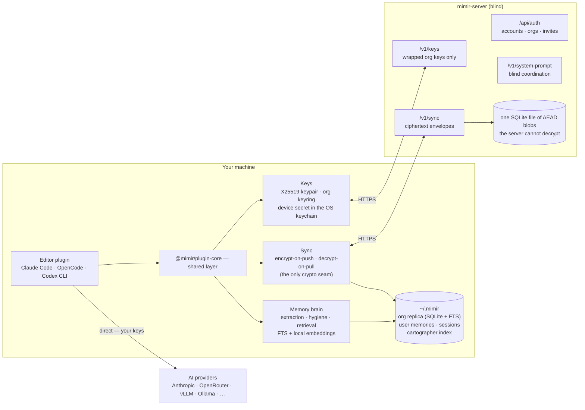

# About Mimir's architecture

What runs on your machine, what runs on the server, and where encryption
happens. For exactly what the server can and cannot see, read
[THREAT_MODEL.md](../THREAT_MODEL.md). To install Mimir, start at the
[README](../README.md).

## Your machine

Storage, embeddings, retrieval and codebase indexing all run locally, in the
shared layer every editor plugin is built on
([`plugin-core`](../packages/plugin-core/README.md)). The plugins are thin
wiring over it, so a user-facing flow never belongs to one editor.

Model calls go from your machine straight to the provider, with your own keys
or your editor's subscription. No inference transits the Mimir server.

## The server

The server has exactly four jobs:

- **Auth**: accounts, orgs, invites.
- **Wrapped-key distribution**: it stores org keys encrypted to each member's
  public key, never the keys themselves.
- **Ciphertext sync**: opaque envelopes with last-write-wins convergence.
- **Blind coordination**: the system prompt and sync leases.

It runs no models, computes no embeddings, and parses no memory content. Its
routes and configuration are in the
[server README](../packages/server/README.md).

## Where encryption happens

Encryption lives at exactly one seam: the sync module. The local replica is
plaintext, because it sits on the same disk as your code. Envelopes are sealed
on push and opened on pull.

Key material follows the 1Password shape: an X25519 keypair per user, the org
data key wrapped per member, and a device secret in the OS credential store.

The mechanics are in
[Keys and sync](../packages/plugin-core/README.md#keys-and-sync). The
guarantees are in [THREAT_MODEL.md](../THREAT_MODEL.md).
